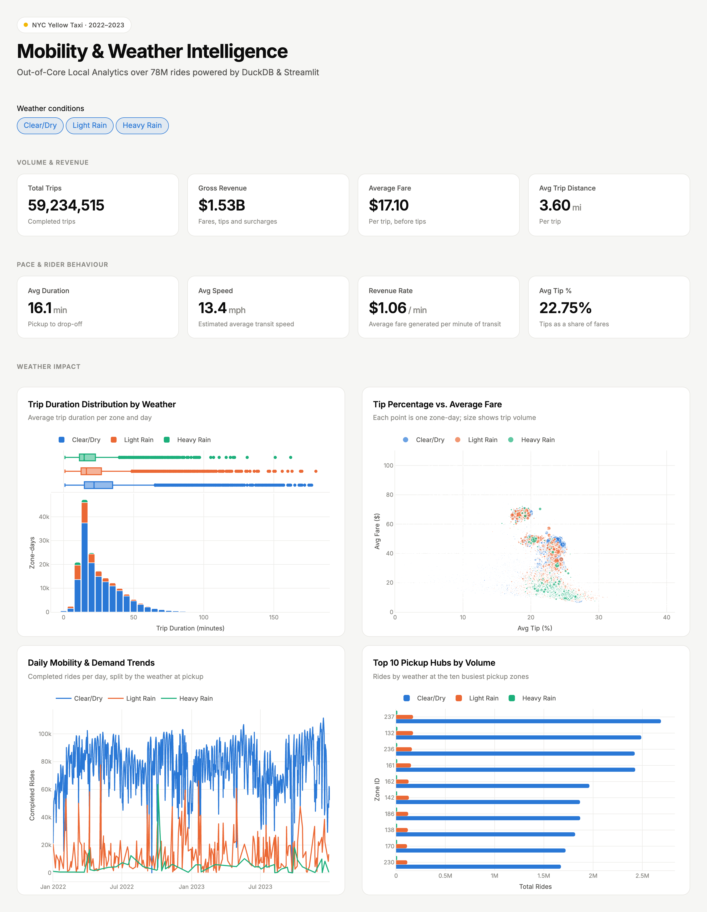
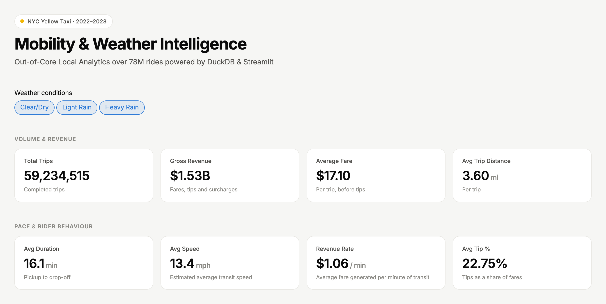
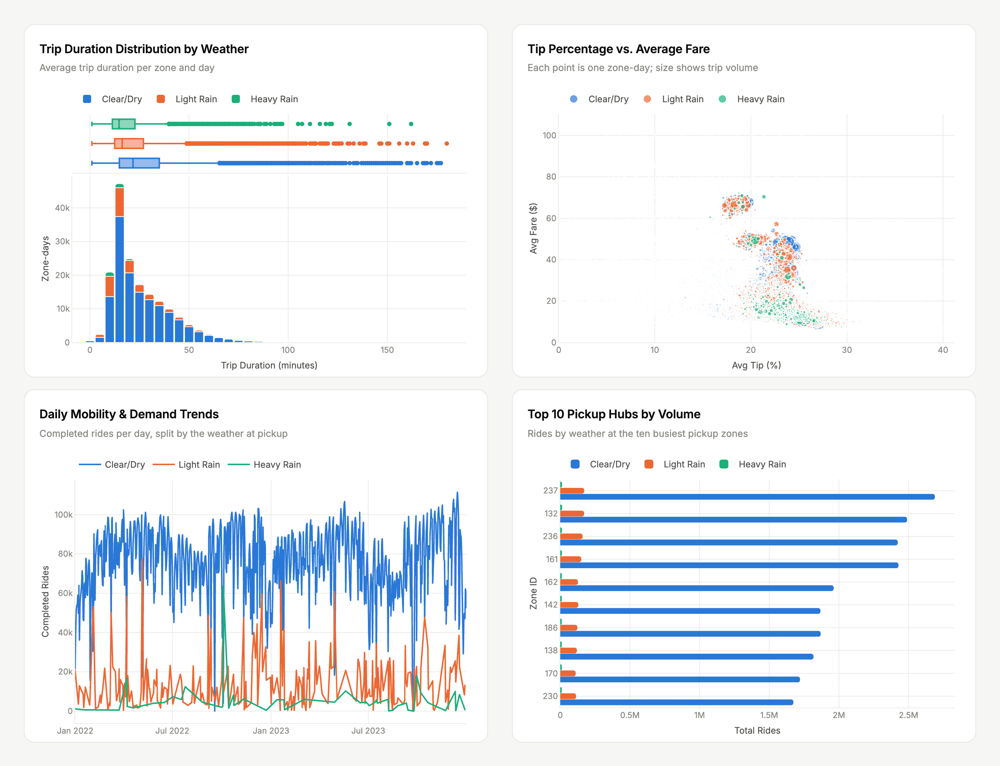

# 🚖 NYC Mobility & Weather Intelligence Engine
*Local-First Analytics Pipeline Processing 78M Taxi Records on an 8 GB M1 MacBook Pro*


<picture>
  <source media="(prefers-color-scheme: dark)" srcset="docs/screenshots/dashboard-dark.png">
  
</picture>

---

## 📌 Executive Summary
Cloud data warehouses (Snowflake, BigQuery) are often treated as default requirements for processing multi-gigabyte datasets. This project demonstrates a **local-first analytics architecture** capable of joining, cleaning, and aggregating **78 million NYC Yellow Taxi trip records (24 monthly Parquet files, 2022–2023, ~1.25 GB on disk)** against historical hourly weather data on an entry-level **8 GB M1 Mac** with sub-4-second analytical execution and zero cloud infrastructure costs.

---

## ⚡ Performance Benchmarks: DuckDB vs. Pandas

| Metric | Traditional Pandas Workflow | DuckDB Local-First Engine |
| :--- | :--- | :--- |
| **Input Scale** | 24 Monthly Parquet Files (78M rows, ~1.25 GB on disk) | 24 Monthly Parquet Files (78M rows, ~1.25 GB on disk) |
| **Peak Memory Footprint** | 💥 **Crashed (OOM > 8 GB)** | 🟢 **~0.9 GB Peak** |
| **Execution Time** | Failed (Kernel Killed by OS) | 🟢 **~3.7 seconds** |
| **Out-of-Core Processing** | ❌ None (Requires memory > file size) | 🟢 Automatic Vectorized Streaming |
| **Compute Cost** | Cloud Server / Spark Instance ($$) | **$0.00 (Local Hardware)** |

---

## 🔍 Key Analytical & Business Insights

Figures cover the 59.2 million trips that pass the cleaning rules below (credit card trips, 2022–2023). "Heavy rain" means more than 5 mm of precipitation in the pickup hour, which occurred in 102 of the 17,520 hours in the period.

* **Demand Dips Modestly in Rain:** Heavy-rain hours see about **7.5% fewer trips** than dry hours on the same weekday and hour of day; light rain (0.5–5 mm/hr) about **1.9% fewer**. Airport pickups (JFK/LGA) fall by a similar **~9%**, with the average airport trip total essentially unchanged ($70.56 dry vs. $69.39 heavy rain).
* **Transit Speed Barely Moves:** Average speed slips from **13.4 mph to 12.9 mph** in heavy rain, while average trip duration stays flat at about **16.1 minutes**.
* **Tipping Is Weather-Insensitive:** The weighted credit card tip rate is **22.75%** in dry hours and **22.66%** in heavy rain.

---

## 🛠️ Data Integrity & Anomaly Resolution Case Study

During pipeline testing, exploratory scatter plots revealed an anomalous average tip percentage exceeding **37,500%**. Root-cause analysis surfaced critical data hygiene challenges in real-world transactional data:

* **The Micro-Fare Phenomenon:** System test records and dispute overrides contained `$0.01` base fares combined with `$30.00` tips ($$\frac{30.00}{0.01} \times 100 = 300,000\%$$).
* **Arithmetic Mean Distortion:** Calculating the average of individual ratios (`AVG(tip / fare)`) gave equal statistical weight to micro-fares and standard trips, skewing aggregate group metrics.

### Engineering & Statistical Fixes Implemented
1. **Weighted Ratio of Sums:** Replaced `AVG(tip / fare)` with `SUM(tip_amount) / SUM(fare_amount)` to weight tips proportionally by real transaction dollars.
2. **Regulatory Sanity Boundaries:** Applied filters enforcing official NYC statutory minimum meter drop rates (`fare_amount >= 2.50`) and excluded terminal typo errors (`tip_amount <= fare_amount * 1.5`).
3. **Electronic Tender Isolation:** Filtered strictly for credit card transactions (`payment_type = 1`), preventing cash payments ($0 recorded tip) from artificially deflating averages.
4. **Robust Statistics:** Introduced `MEDIAN()` alongside weighted averages to maintain outlier-resistant measures.

---

## 📊 Streamlit Business Intelligence Dashboard

The application reads the pre-aggregated summary Parquet file to render a full-featured BI dashboard in under 200 ms:

### 1. 8-KPI Executive Scorecard
* **Volume & Revenue:** Total Completed Trips, Gross Revenue, Average Fare ($), Average Trip Distance (mi).
* **Operational Pace & Behavior:** Average Trip Duration (min), Average Speed (mph), Revenue Rate ($/min), Average Tip (%).



### 2. Analytical Visualizations
* **Trip Duration Distribution:** Overlaid histograms and marginal box plots showing duration shifts across clear, light rain, and heavy rain conditions.
* **Tip Percentage vs. Average Fare:** Multi-variable scatter plot examining tipping elasticity and fare distributions.
* **Daily Mobility & Demand Trends:** Multi-line time series tracking daily completed rides over multi-year periods.
* **Top 10 Pickup Hubs:** Grouped horizontal bar charts comparing weather resilience across major transit zones.



The dashboard follows the viewer's light or dark theme.

---

## 🏗️ Architecture & Data Flow

```text
NYC TLC (Parquet) [~1.25 GB]─┐
                             ├─► DuckDB Vectorized SQL Engine ──► Processed Summary ──► Streamlit BI App
Open-Meteo Weather [CSV]    ──┘    (Filtered, Cleaned, Joined)        (Parquet, ~3 MB)
```
